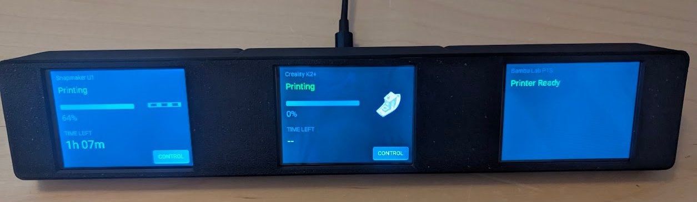
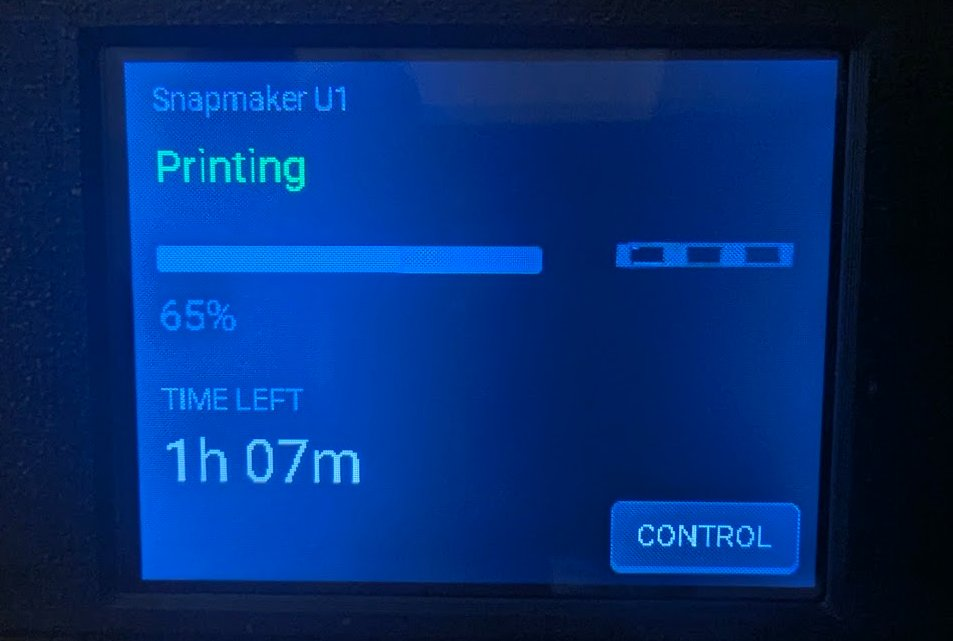
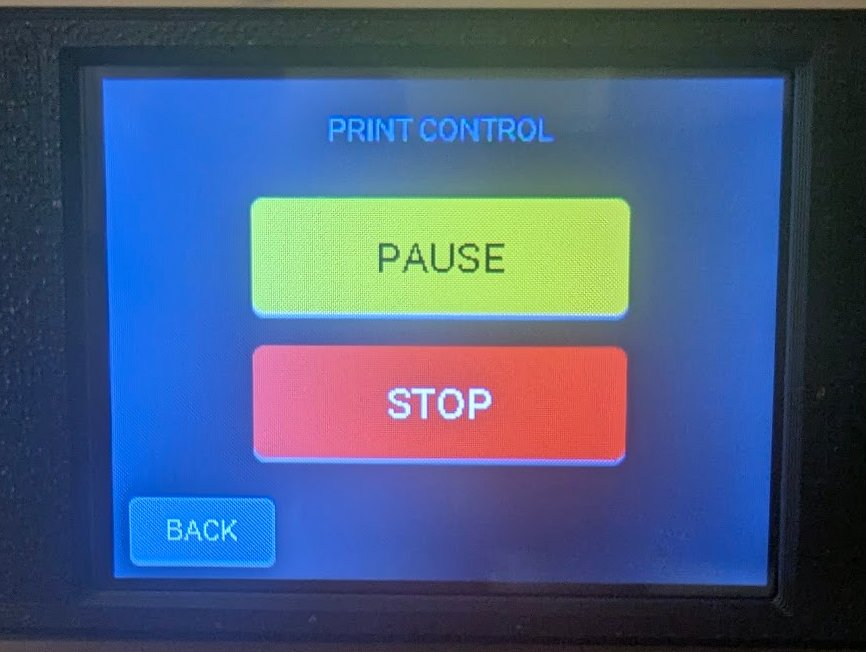
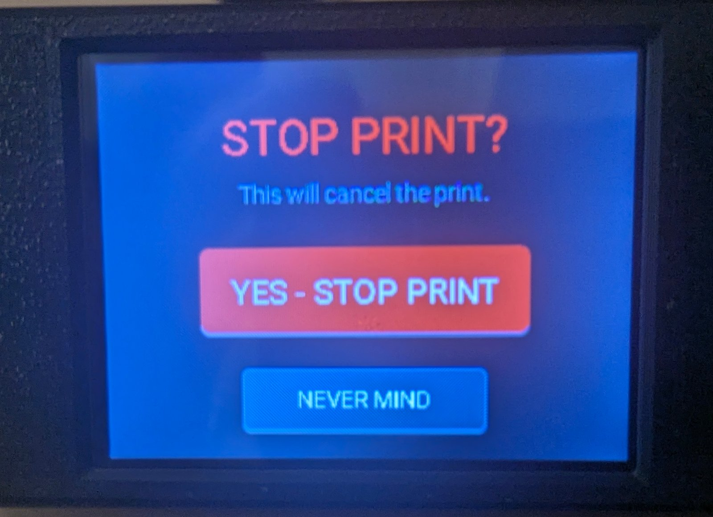
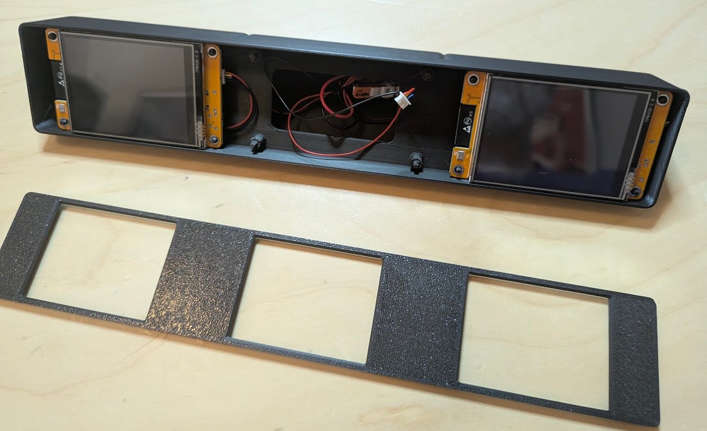
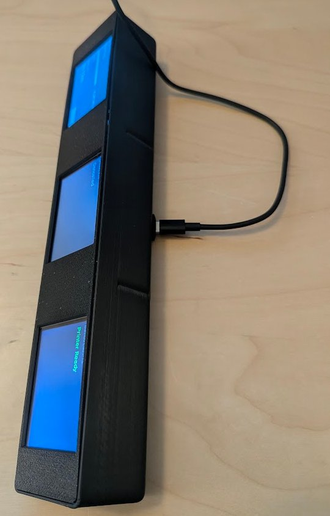
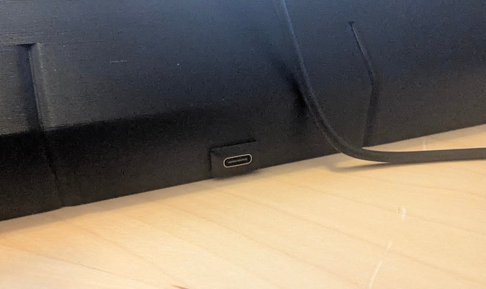
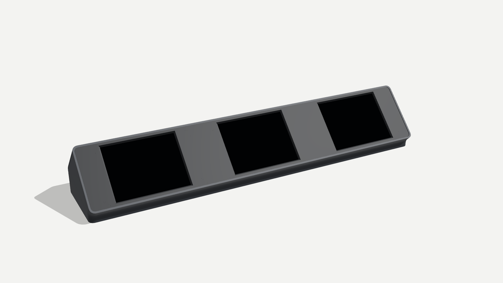
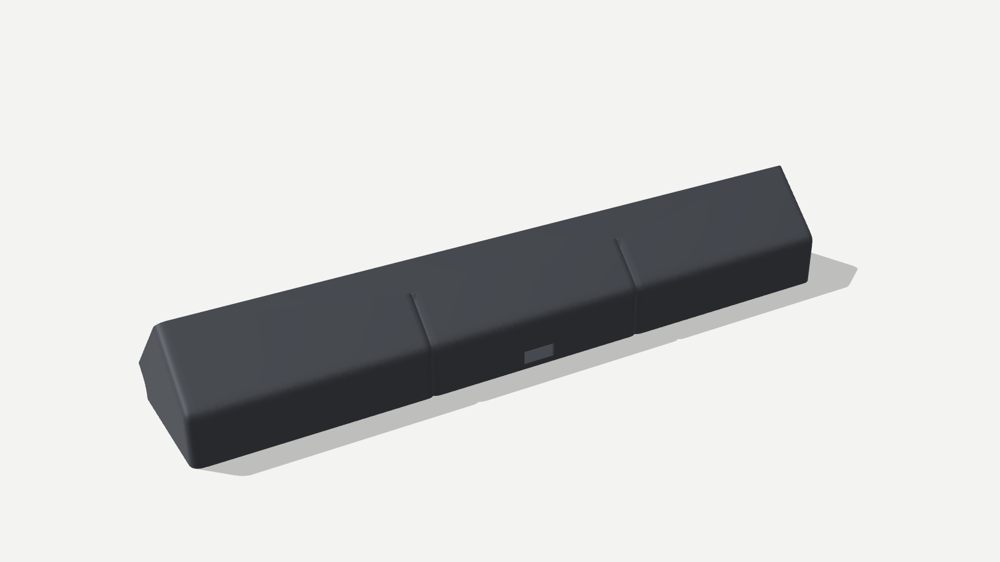

# CYD 3D Printer Status Display



A small touchscreen status display for 3D printers, built on the ESP32 "Cheap Yellow Display" (CYD), ESPHome and Home Assistant.

Supported printers:

| Printer | Data source | Device file |
|---|---|---|
| Snapmaker U1 | Moonraker integration | `devices/snapmaker-u1.yaml` |
| Creality K2+ | Moonraker integration | `devices/creality-k2-plus.yaml` |
| Bambu Lab P1S | ha-bambulab integration | `devices/bambulab-p1s.yaml` |

Any Klipper/Moonraker printer should work with the Moonraker device file. Any printer supported by ha-bambulab should work with the Bambu device file.

## What it shows

- Printer state: Printing, Paused, Preparing, Print Complete, Cancelled, Error, Printer Ready, Offline, Unknown (no data from Home Assistant). A cancelled print returns to "Printer Ready" after 30 minutes.
- Progress bar, percent and time left.
- The current job's thumbnail.
- Printer control: a control page with Pause, Resume and Stop (Stop asks for confirmation). This only works after you allow the display to perform Home Assistant actions (setup step 8).
- A PRINT REMOVED button after a print completes, to acknowledge the bed is clear.

| Status | Print control | Stop confirmation |
|---|---|---|
|  |  |  |

Backlight behavior:

- 100% while printing, paused or preparing.
- 100% while the printer reports an error, so it gets noticed.
- 100% for 6 hours after a print completes or is cancelled, then 25%.
- 25% when idle. Touching the screen wakes it to 100% for 15 minutes.

## Hardware

- ESP32-2432S028 CYD: 2.8" 320x240 ILI9341 display with XPT2046 resistive touch. The config uses ILI9341 initialization with a gamma table tuned for the board variant it was built on ("9342"). CYD boards are sold in several variants. If your screen stays blank, shows wrong colors, or touch is mirrored, your board differs and needs a different `packages/hardware/` file.
- Power: 5 V over USB. A bare CYD needs no wiring; the display, touch and backlight are on the board.
- A USB data cable for the first flash. Some cables are charge-only and will not work.
- In the three-display case, one USB-C panel port in the base is wired to each board's power connector, so a single cable powers all three (see the assembly photo below).
- Optional: the printed case in `case/` (see below).

## How the config is organized

```
devices/              one small file per display. This is the only file you edit.
packages/
  base.yaml           ESP32, Wi-Fi, API, OTA
  hardware/           CYD pins, display, touch, backlight
  ui.yaml             screens, backlight policy, state logic
  backends/
    moonraker.yaml    Moonraker printers
    bambulab.yaml     Bambu printers via ha-bambulab
case/                 printable case (STEP)
images/               photos and renders
secrets.yaml.example  template for your secrets.yaml
```

Device files pull the packages straight from this repository with `github://` remote packages pinned to a release tag, for example:

```yaml
packages:
  ui: github://jsheheane/CYD-3d-Printer-Status/packages/ui.yaml@v1.1.0
```

To update, change `@v1.1.0` to a newer tag on all four lines and install again. Your ESPHome host needs internet access to download the packages.

Validated with ESPHome 2026.9.1.

## Already running ESPHome?

If you already have Home Assistant, the ESPHome dashboard and HACS working, this is the short version. The full steps follow below.

1. Install the printer integration (Moonraker or ha-bambulab) and note the printer's entity prefix (setup steps 1 and 2).
2. Add an API key for the display to your existing `secrets.yaml`. Keep your current Wi-Fi secrets.
3. Create a device in the ESPHome dashboard, paste in the matching file from `devices/`, and set the substitutions. If your Wi-Fi secrets use other names, change `!secret wifi_ssid` and `!secret wifi_password` to match.
4. Install, then allow Home Assistant actions for the display (setup steps 7 and 8).

Notes for existing setups:

- **Nothing else in your config changes.** Each display is one self-contained device file. The packages are downloaded from GitHub when you build, so you don't copy any other files.
- **Reusing a CYD that already runs ESPHome:** set `device_name` to its current node name and `api_encryption_key` to its current key. It then installs wirelessly and keeps its existing Home Assistant device. If its old firmware used the Arduino framework, the first install may need USB, because this config uses ESP-IDF.
- **Adding your own settings:** put them in the device file under the substitutions. They merge with the packages. For example, a static IP:

  ```yaml
  wifi:
    manual_ip:
      static_ip: 192.168.1.60
      gateway: 192.168.1.1
      subnet: 255.255.255.0
  ```

  Don't add a second `api:`, `ota:` or `wifi:` with the same settings. The packages already provide them.
- **Using local copies instead of GitHub** (to edit the packages or build offline): copy the `packages/` folder to `/config/esphome/cyd-packages/`, then replace each `github://` line in the device file with a local include:

  ```yaml
  packages:
    base: !include cyd-packages/base.yaml
    hardware: !include cyd-packages/hardware/cyd-2432s028-9342.yaml
    ui: !include cyd-packages/ui.yaml
    backend: !include cyd-packages/backends/moonraker.yaml
  ```

  The ESPHome dashboard only lists files at the top of `/config/esphome/`, so the packages folder does not show up as devices. Local copies do not update when you change a tag.

## Setup

### Before you start

You need:

- Home Assistant with the **ESPHome Device Builder** add-on (Settings > Add-ons > Add-on store). This README calls it the ESPHome dashboard.
- [HACS](https://hacs.xyz) for the printer integrations.
- The display and the printer on the same network as Home Assistant.

### 1. Printer integration

Moonraker printers (Snapmaker U1, Creality K2+, other Klipper printers):

- Install the [Moonraker integration](https://github.com/marcolivierarsenault/moonraker-home-assistant) from HACS, restart Home Assistant, then add the printer under Settings > Devices & services.

Bambu printers:

- Install [ha-bambulab](https://github.com/greghesp/ha-bambulab) from HACS, restart Home Assistant, then add the printer.
- Check that the printer's cover image entity (`image.<prefix>_cover_image`) exists and is enabled.

### 2. Find your entity prefix

The display reads the printer's Home Assistant entities by name. Go to Settings > Devices & services > Entities and search for `progress`.

- Moonraker: if you find `sensor.k2_plus_progress`, your prefix is `k2_plus`.
- Bambu: if you find `sensor.p1s_print_progress`, your prefix is `p1s`.

If some entities do not follow the pattern, you can override them one by one (step 5).

### 3. Reserve IP addresses

Some addresses are built into the display's firmware. If they change, thumbnails stop loading until you reinstall. Reserve them in your router (often called a DHCP reservation or static lease):

- Moonraker printers: the printer's IP. The display downloads thumbnails from `moonraker_url`.
- Bambu printers: the Home Assistant host's IP. The display downloads the cover image from `ha_base_url`. Reserving the printer's IP is also recommended for ha-bambulab in LAN mode.

### 4. Secrets

In the ESPHome dashboard, click **Secrets** (top right) and add the entries from `secrets.yaml.example`:

- `wifi_ssid` and `wifi_password`: your Wi-Fi. If they are already there, keep them.
- One API encryption key per display, for example `k2_plus_api_key`. Each key is 32 random bytes in base64. Copy a fresh one from the [ESPHome API docs](https://esphome.io/components/api/) (the example key is randomly generated each time the page loads), or run `openssl rand -base64 32`.

### 5. Create the device

1. In the ESPHome dashboard, click **+ New device**, give it a name, and skip the install step.
2. Click **Edit** on the new device, replace everything in the file with the contents of the matching file from `devices/`, and save.
3. Change the substitutions at the top:

| Substitution | Used by | Meaning |
|---|---|---|
| `device_name` | all | ESPHome node name: lowercase letters, numbers and hyphens. Unique per display |
| `friendly_name` | all | Name shown in Home Assistant |
| `printer_title` | all | Title shown on the screen |
| `entity_prefix` | all | From step 2 |
| `api_encryption_key` | all | Name of this display's key in secrets, after `!secret` |
| `wifi_ssid`, `wifi_password` | all | Names of your Wi-Fi secrets, after `!secret` |
| `moonraker_url` | Moonraker | `http://<printer-ip>:7125` |
| `thumb_size` | Moonraker | Thumbnail size to fetch. Default `96x96`. Uncomment only to change it |
| `ha_base_url` | Bambu | Local Home Assistant address, for example `http://192.168.1.10:8123`. Use the local `http://` address, not a Nabu Casa or other remote URL |

Optional overrides. Add these under `substitutions:` only if needed:

| Substitution | Default | When to change |
|---|---|---|
| `touch_x_min`, `touch_x_max`, `touch_y_min`, `touch_y_max` | `323`, `3754`, `232`, `3724` | Touches land in the wrong place |
| `display_rotation` | `180` | The image is upside down |

If an entity does not follow the `<prefix>` pattern, override it with its full entity ID:

| Moonraker substitution | Default entity |
|---|---|
| `state_entity` | `sensor.<prefix>_current_print_state` |
| `filename_entity` | `sensor.<prefix>_filename` |
| `progress_entity` | `sensor.<prefix>_progress` |
| `time_left_entity` | `sensor.<prefix>_print_time_left` (hours) |
| `pause_entity` | `button.<prefix>_pause_print` |
| `resume_entity` | `button.<prefix>_resume_print` |
| `stop_entity` | `button.<prefix>_cancel_print` |

| Bambu substitution | Default entity |
|---|---|
| `status_entity` | `sensor.<prefix>_print_status` |
| `error_entity` | `binary_sensor.<prefix>_print_error` |
| `cover_entity` | `image.<prefix>_cover_image` |
| `progress_entity` | `sensor.<prefix>_print_progress` |
| `time_left_entity` | `sensor.<prefix>_remaining_time` (minutes) |
| `pause_entity` | `button.<prefix>_pause_printing` |
| `resume_entity` | `button.<prefix>_resume_printing` |
| `stop_entity` | `button.<prefix>_stop_printing` |

Click **Validate** in the device's menu to check the file before installing.

### 6. Slicer thumbnails (Moonraker printers only)

The display shows the small PNG thumbnail that your slicer embeds in the G-code. Make sure one of them is 96x96 (or whatever `thumb_size` is set to):

- In OrcaSlicer-based slicers (OrcaSlicer, Snapmaker Orca, Creality Print), open the printer settings and find **G-code thumbnails**. Add `96x96/PNG` to the list, separated by a comma. Keep the sizes already there, since the printer's own screen uses them.
- Re-slice the file after changing this. Existing G-code files will not have the new thumbnail.

Larger thumbnails are not used because the CYD has very little memory.

### 7. Install

The first install must be over USB. Flash each board before assembling the case.

1. In the ESPHome dashboard, click **Install** on the device and choose **Manual download**. The first build can take several minutes.
2. When it finishes, download the **Factory format** file.
3. Plug the CYD into your computer, open [ESPHome Web](https://web.esphome.io) in Chrome or Edge, click **Connect**, pick the serial port, then **Install** and choose the downloaded file.

If no serial port appears, install the CH340 USB driver for your operating system, and check that the cable carries data.

After the first install, updates go over Wi-Fi: click **Install** and choose **Wirelessly**.

### 8. Add to Home Assistant

1. Home Assistant shows the display under Settings > Devices & services as discovered. Click **Add**. If asked for an encryption key, use this display's key from secrets.
2. On the ESPHome integration, open the display's entry, click **Configure**, enable **Allow the device to perform Home Assistant actions**, and submit. Without this, Pause, Resume and Stop do nothing.

### Troubleshooting

| Symptom | Check |
|---|---|
| Screen shows "Unknown" | `entity_prefix` (step 2). Open the display's logs in the ESPHome dashboard for entity errors |
| Progress shows, no thumbnail (Moonraker) | Slicer thumbnail size (step 6), `moonraker_url` |
| No thumbnail (Bambu) | `ha_base_url` is the local `http://` address, cover image entity enabled |
| Buttons do nothing | Home Assistant actions allowed (step 8) |
| Install fails downloading packages | The ESPHome host needs internet access to github.com |

## Case



`case/` holds the STEP files for a three-display desk stand. I designed it for three displays because that is what I needed. Feel free to edit the STEP files to fit your own setup, with as many screens combined into one stand as you like.

| File | Part | Size (mm) |
|---|---|---|
| `3-Screen-Base.step` | Wedge base. Displays mount on the 45° face | 296 x 65 x 49 |
| `3-Screen-Bezel.step` | Front bezel with three windows | 292 x ~54, flat plate |

Bed size: the base is 296 mm long. It fits a 300 mm or larger bed straight, and a 270 mm bed diagonally. On a 256 mm bed (P1S, X1, A1) it fits only diagonally with under 1 mm to spare, which is not practical.

| Side | USB-C power port |
|---|---|
|  |  |

Renders from the STEP files:

| Front | Rear |
|---|---|
|  |  |

Print settings: PLA, 0.2 mm layer height. Print the base as it sits in use, on its flat bottom (the STEP file is already oriented this way). Print the bezel face down; its STEP file is exported at 45°, so lay it flat in the slicer. Supports are recommended but not strictly required.

Assembly: no screws. Flash all three boards first (setup step 7). The bezel snaps onto the base over the displays. Glue is optional.

## License

MIT, covering both the configuration and the case files. See `LICENSE`.
